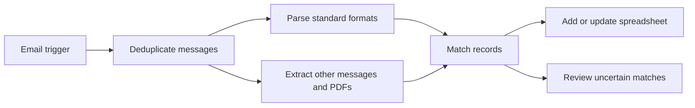

# Procurement Email Pipeline

An n8n workflow that extracts procurement information from messages and PDF invoices, matches it against a spreadsheet register, and routes uncertain records for review.

This repository contains a sanitised portfolio template. It retains the workflow code and node connections; credentials, resource identifiers and organisation-specific examples have been removed or replaced. No real messages, attachments or purchase records are included.

## Workflow

The implementation combines JavaScript parsers for predictable message formats with an LLM extraction step for less structured input. It supports order-reference matching, item matching, duplicate checks, and separate invoice/receipt forwarding nodes.

**Stack:** n8n, JavaScript, Anthropic API, Gmail, Microsoft Excel.

## Import and Configure

1. In a new n8n workflow, choose **Import from File** and select `workflow/procurement-pipeline.json`.
2. Create your own Gmail OAuth2, Microsoft Excel OAuth2 and HTTP Header Auth credentials. The latter uses an `x-api-key` header for the Anthropic API. Assign them to the relevant nodes.
3. Replace `YOUR_WORKBOOK_ID`, `YOUR_WORKSHEET_ID` and `YOUR_TABLE_ID` with resources in a test environment. Each node must point to the appropriate orders or review table; the repeated placeholders do not imply the same table everywhere.
4. Replace the `example.com` mail addresses with test recipients before enabling forwarding. Leave those nodes disconnected or disabled if forwarding is not required.
5. Select a model available to your API account and adjust the Gmail filter for your test inbox.
6. Test with synthetic messages before activating the workflow. The exported workflow is inactive and is not exposed through MCP.

The example orders table uses `Date`, `Who`, `product`, `SKU`, `volume`, `State`, `Items`, `Price (Inclu. VAT)`, `Supplier`, `URL`, `Status`, `Estimated delivery date`, `OrderNo`, `LineKey`, and `Invoice sent to accountant`. The review table uses `When`, `Reason`, `Supplier`, `Product`, `OrderNo`, `Status`, and `Subject`. Adapt these mappings to your own schema. Buyer-name extraction is blank by default; the supplier-domain lookup starts empty.

## Data Handling

When configured and executed, the extraction nodes send message content or PDF contents to an external LLM API. Forwarding nodes send invoices or receipts to the configured recipients. Connect only data and accounts that you are authorised to use for those operations. The JSON is a template, not an isolated test environment.

Node credentials are references to n8n's credential store, not embedded keys. Keep execution exports, attachments, local credentials and test data out of Git. The repository includes no deployment credentials or live resource links.

## Evaluation

The `evals/` folder contains a test harness for the extraction step. It runs 30 synthetic emails through two prompt versions, scores each field against a written expected answer, and reports accuracy. It uses no real data, the API key is read from an environment variable only, and an offline scan blocks pushes that contain credentials. On the current set, the original prompt scored 84/90 and the rewritten one 90/90; the caveats are in `evals/README.md`.

## Limitations

The template requires account-specific configuration. Parser coverage, matching decisions and LLM output must be tested on synthetic inputs before use; uncertain extraction is not a substitute for human review. It is not a guarantee of accounting correctness.
